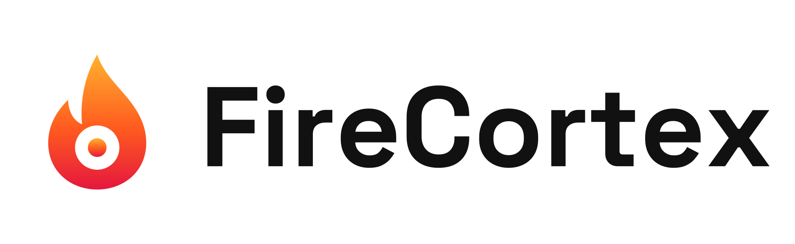
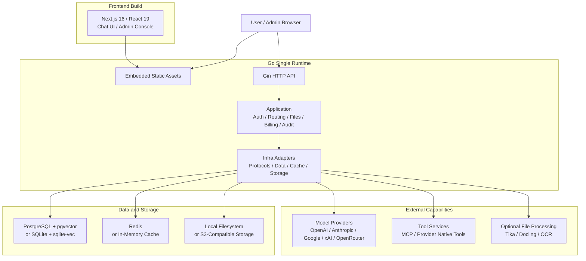

<p align="center">
  <picture>
    <source media="(prefers-color-scheme: dark)" srcset="./frontend/public/logo-white.svg" />
    
  </picture>
</p>

<p align="center">
  Your external brain: one chat box that routes, equips, and runs whatever it takes to get things done.
</p>

<p align="center">
  English | <a href="./docs/README.zh-CN.md">简体中文</a>
</p>

<p align="center">
  <a href="https://github.com/lieyanc/FireCortex/releases"></a>
  <a href="https://www.apache.org/licenses/LICENSE-2.0"></a>
  
  
  
</p>

## Overview

FireCortex is a self-hosted AI workspace built around one idea: a single chat box should be enough. Instead of making you pick a model, toggle tools, and orchestrate steps by hand, FireCortex works as an external brain that decides how each request gets handled:

- **Intelligent model routing**: choose the model that fits each request by task type, required capabilities, context size, latency, and cost.
- **Adaptive tool injection**: expose only the tools, MCP servers, files, and memory a request actually needs, keeping prompts small and tool selection accurate.
- **Agent runtime**: plan, call tools, observe results, and iterate across multiple steps until the task is done, with every step traceable.

FireCortex is derived from [DEEIX Chat](https://github.com/DEEIX-AI/DEEIX-Chat) v0.4.3 and inherits its production-grade foundation: multi-provider access, files and RAG, MCP tools, billing, identity, audit, and a lightweight single-runtime deployment. <!-- rebrand:keep -->

## Roadmap

| Capability | Status |
| --- | --- |
| FireCortex rebrand | Done |
| Intelligent model routing | Planned |
| Adaptive tool injection | Planned |
| Agent runtime | Planned |

## Features

The capabilities below are inherited from upstream and available today.

| Area | Capabilities |
| --- | --- |
| Conversations | A multimodal chat interface for daily use, with streaming, branches, retries, edits, feedback, sharing, rich rendering, and traceable model execution metadata. |
| Models and routing | A platform-model layer for upstream channels, real models, route bindings, priority, weights, circuit breaking, vendor mapping, and capability configuration, reducing the cost of multi-provider operations. |
| Protocols and adaptation | Unified support for OpenAI, Anthropic, Google/Gemini, xAI, OpenRouter, and OpenAI-compatible protocols across text, image, tools, and provider-native capability differences. |
| Files and retrieval | File upload, preview, extraction, OCR, storage quota, full-context injection, chunking, embeddings, and semantic retrieval so file content can naturally enter the conversation context. |
| Tool ecosystem | MCP servers and provider-native official tools with discovery, enablement, user selection, execution limits, result rendering, and tool-call traceability. |
| Context and memory | Message windows, token budgets, summary compression, conversation memory, long-term memory, and RAG evidence records for controlled-cost continuity. |
| Billing and payments | Model pricing, per-call tool pricing, subscriptions, top-ups, balances, usage ledgers, billing snapshots, Stripe Checkout, EPay, and webhook validation. |
| Identity and security | Local accounts, session management, HttpOnly refresh cookies, 2FA/TOTP, trusted devices, SSO/OIDC/OAuth, contact verification, and encrypted sensitive data. |
| Administration and audit | Centralized management for users, roles, upstreams, models, routes, pricing, subscriptions, balances, usage logs, audit logs, auth events, and system events. |
| Deployment and operations | Single self-contained binary serving the frontend and API, built-in OTA updates from GitHub Releases, SQLite or PostgreSQL, in-memory cache or Redis, S3-compatible storage, Swagger, structured logs, version endpoint, GeoIP, and OpenTelemetry. |

## Architecture and Tech Stack

FireCortex uses a split frontend/backend development model with a single-runtime deployment path. The frontend is built into static assets that are embedded in the Go binary and served by it, while APIs, authorization, model routing, files, billing, and audit capabilities run in the same backend runtime. Heavy document extraction and OCR capabilities are optional services, keeping the base deployment lightweight.



| Layer | Responsibility | Technologies |
| --- | --- | --- |
| Frontend | Chat UI, admin console, and static builds | Next.js 16, React 19, TypeScript, Tailwind CSS, Shadcn/UI, Streamdown, KaTeX, Mermaid, Recharts, Motion |
| Backend runtime | APIs, authentication, authorization, orchestration, protocol adaptation, and static serving | Go 1.26, Gin, Gorm, Swagger, OpenTelemetry, Zap |
| Data and cache | Domain data, vector retrieval, session state, and runtime cache | PostgreSQL, pgvector, SQLite, sqlite-vec, Redis, in-memory cache |
| Files and storage | Uploaded files, generated files, object storage, and local persistence | Local filesystem, S3-compatible object storage |
| File processing | Text extraction, OCR, document parsing, and LLM OCR fallback | Built-in extractors, Apache Tika, Docling, RapidOCR, Tesseract OCR, Paddle OCR, cloud OCR adapters, MinerU |
| Tool protocol | MCP tool integration and provider-native official tools | MCP Streamable HTTP JSON-RPC, provider-native tools |
| Deployment runtime | Lightweight single-node deployment or multi-node production deployment | Single binary with embedded UI, systemd, OTA self-update, SQLite/in-memory cache, PostgreSQL/Redis |

The backend keeps clear internal boundaries: `backend/cmd/server` is the executable entrypoint, `backend/internal/cli` owns process startup, `backend/internal/app` assembles and wires the application, and `backend/internal/transport/http` owns the HTTP boundary. Requests then flow through `application` use cases to consumer-owned `repository` or `ports` interfaces and their `infra` implementations. The data layer uses domain-prefixed tables, while financial records, audit trails, system events, and high-growth vector data remain separate sources of truth.

## Repository Layout

```text
.
├── backend/                  # Go API and single-runtime server
│   ├── cmd/server/            # executable entrypoint
│   ├── internal/
│   │   ├── cli/               # process startup
│   │   ├── app/               # dependency wiring and lifecycle
│   │   ├── application/       # use cases and orchestration
│   │   ├── domain/            # business concepts and rules
│   │   ├── ports/              # outbound integration contracts
│   │   ├── repository/         # persistence contracts
│   │   ├── infra/              # persistence, cache, storage, providers
│   │   ├── transport/http/     # handlers, DTOs, middleware, routes
│   │   ├── webui/              # embedded web UI (go:embed)
│   │   └── shared/             # cross-cutting response and security code
│   └── docs/                  # generated Swagger artifacts
├── frontend/                 # Next.js App Router and static export
│   ├── app/                   # route entries and layouts
│   ├── features/              # feature-owned UI and client workflows
│   ├── entities/              # reusable business entities
│   ├── shared/                # API, auth, UI, hooks, models, utilities
│   ├── components/            # UI primitives and visual components
│   └── public/                # static assets
├── packages/api-contract/     # generated TypeScript API contract
├── docker/                    # optional extraction and OCR services
├── deploy/                    # systemd unit example
├── docs/                      # project guides
├── scripts/                   # binary build, rebrand, and upstream sync scripts
└── config*.example.yaml       # deployment profile templates
```

`frontend/` and `backend/` are independent workspaces managed by pnpm and Turborepo. `packages/api-contract/` connects them through generated Swagger types; update the Go transport contract first, then regenerate the shared package.

## Prerequisites

- Node.js 20.9 or newer for development (release builds and CI use Node.js 24).
- pnpm 10.17.0, normally enabled through Corepack.
- Go 1.26.8 for backend development.
- A C compiler and SQLite headers (`libsqlite3-dev` on Debian/Ubuntu), because the backend builds with CGO.
- PostgreSQL with pgvector and Redis for the default development configuration.

Running a release binary needs none of these. The SQLite profile does not require a separately managed database or cache. The default development configuration uses PostgreSQL and Redis.

## Quick Start

> Quick installation guide: [Quick Start](https://github.com/lieyanc/FireCortex).

### Local Development

Local development is intended for editing source code and running the frontend and backend separately. The default config connects to local PostgreSQL and Redis. If you only want a low-dependency trial, use a release binary with the lightweight SQLite profile below.

1. Prepare backend configuration:

```bash
cp config.example.yaml config.yaml
```

Adjust `database.postgres.dsn`, `database.redis.*`, and public URLs in `config.yaml` for your local environment.

2. Install workspace dependencies and prepare the frontend environment:

```bash
pnpm install
cp frontend/.env.example frontend/.env.local
```

3. Start the frontend and backend together:

```bash
pnpm dev
```

Use `pnpm dev:web` or `pnpm dev:api` to start only one workspace.

The frontend uses `NEXT_PUBLIC_API_BASE_URL` for API requests. For local development, confirm that `frontend/.env.local` contains:

```env
NEXT_PUBLIC_API_BASE_URL=http://127.0.0.1:8080
```

Service URLs and probes:

| Service | URL |
| --- | --- |
| Frontend | `http://localhost:3000` |
| API | `http://localhost:8080` |
| Liveness | `http://localhost:8080/healthz` |
| Readiness | `http://localhost:8080/readyz` |
| Version | `http://localhost:8080/api/v1/version` |
| Swagger (development only) | `http://localhost:8080/swagger/index.html` |

If `NEXT_PUBLIC_API_BASE_URL` is omitted, local development defaults to `localhost:8080`; same-origin deployments use the current origin.

### Workspace Commands

Run workspace commands from the repository root:

| Command | Purpose |
| --- | --- |
| `pnpm dev` | Start the frontend and backend in watch mode. |
| `pnpm dev:web` | Start only the Next.js frontend. |
| `pnpm dev:api` | Start only the Go API. |
| `pnpm check` | Run workspace lint, type, backend version, and API contract checks. |
| `pnpm test` | Run workspace tests. |
| `pnpm build` | Build the static frontend and backend binary. |
| `pnpm build:binary` | Build the single self-contained binary with the embedded UI into `dist/firecortex`. |
| `pnpm verify` | Run checks, tests, and builds together. |
| `pnpm api:generate` | Regenerate Swagger artifacts and TypeScript API types. |
| `pnpm api:check` | Check that generated API artifacts are up to date. |

The frontend is exported as static files, so `pnpm build` writes the browser artifact to `frontend/out`. `pnpm build:binary` embeds that output into the Go binary; see [Build from Source](#build-from-source).

### Binary Deployment

FireCortex ships as a single self-contained binary. The web UI is embedded in the executable, and one process serves both the API and the UI on `server.http_port` (default `8080`). Each [GitHub Release](https://github.com/lieyanc/FireCortex/releases) provides:

| Asset | Platform |
| --- | --- |
| `firecortex-linux-amd64` | Linux x86-64, glibc 2.35 or newer (Debian 12+, Ubuntu 22.04+) |
| `firecortex-linux-arm64` | Linux ARM64, glibc 2.35 or newer (Debian 12+, Ubuntu 22.04+) |
| `firecortex-darwin-arm64` | macOS on Apple silicon |
| `SHA256SUMS` | SHA-256 checksums for the binaries |
| `version.json` | Release metadata used by the built-in updater |

Stable releases are published from `vX.Y.Z` tags. Every push to the `dev` branch also publishes a rolling prerelease under the `dev-latest` tag. Windows builds are not provided.

Choose a configuration profile first:

| Profile | Use case | Config file | External services |
| --- | --- | --- | --- |
| Lightweight | Local evaluation, personal use, small single-node deployments | `config.sqlite.example.yaml` | None. SQLite + sqlite-vec + in-memory cache |
| PostgreSQL + Redis | Multi-node or high-concurrency production deployments | `config.full.example.yaml` | PostgreSQL with pgvector, Redis |
| Development | Source development with `pnpm dev` | `config.example.yaml` | PostgreSQL with pgvector, Redis |

SQLite + memory cache is single-process only. It is good for local use, evaluation, and small single-node deployments. Use PostgreSQL + Redis for multi-node or high-concurrency production deployments.

#### 1. Install the Binary

The commands below install the latest stable release for Linux x86-64 into `/opt/firecortex`. Replace the asset name for other platforms, or replace `latest/download` with `download/dev-latest` to follow the `dev` prerelease.

```bash
sudo install -d /opt/firecortex && cd /opt/firecortex
base=https://github.com/lieyanc/FireCortex/releases/latest/download
sudo curl -fLO "$base/firecortex-linux-amd64"
sudo curl -fLO "$base/SHA256SUMS"
sha256sum -c SHA256SUMS --ignore-missing
sudo mv firecortex-linux-amd64 firecortex
sudo chmod +x firecortex
```

On macOS, verify with `shasum -a 256 -c SHA256SUMS --ignore-missing`.

#### 2. Prepare `config.yaml`

The binary reads `./config.yaml` or `../config.yaml` relative to its working directory, or the file named by `CONFIG_FILE`. Relative paths inside the config file, such as `./data/firecortex.db` and `./storage`, resolve against the directory that contains the config file.

```bash
ref=dev   # or the release tag you installed
sudo curl -fL -o config.yaml "https://raw.githubusercontent.com/lieyanc/FireCortex/$ref/config.sqlite.example.yaml"
```

Use `config.full.example.yaml` instead for the PostgreSQL + Redis profile. Before exposing the service, set `app.env: prod`, replace `security.jwt_secret` and `security.data_encryption_key` with strong random values, and set `server.public_api_base_url`, `server.public_web_base_url`, and `server.cors_allow_origin` to your public HTTPS origin.

The PostgreSQL + Redis profile needs both services reachable from the host. PostgreSQL needs the pgvector extension for embeddings, RAG, and semantic context; FireCortex runs `CREATE EXTENSION IF NOT EXISTS vector` on startup, so run it once as a superuser if the application role cannot create extensions. If you prefer containers for these dependencies, the following commands match the credentials in `config.full.example.yaml` (change the passwords for real deployments):

```bash
docker run -d --name firecortex-postgres --restart unless-stopped \
  -e POSTGRES_USER=firecortex -e POSTGRES_PASSWORD=firecortex_2026 -e POSTGRES_DB=firecortex \
  -p 127.0.0.1:5432:5432 -v firecortex-postgres-data:/var/lib/postgresql/data \
  pgvector/pgvector:pg16
docker run -d --name firecortex-redis --restart unless-stopped \
  -p 127.0.0.1:6379:6379 -v firecortex-redis-data:/data \
  redis:7 redis-server --requirepass firecortex_2026
```

#### 3. Run

For a quick trial, run the binary from the directory that contains `config.yaml`:

```bash
./firecortex
```

For long-running deployments, use the systemd unit in [`deploy/firecortex.service`](./deploy/firecortex.service). It runs FireCortex as a dedicated `firecortex` user from `/opt/firecortex` with `Restart=always` and filesystem hardening that keeps `/opt/firecortex` writable for self-update:

```bash
sudo useradd --system --home-dir /opt/firecortex --shell /usr/sbin/nologin firecortex
sudo chown -R firecortex:firecortex /opt/firecortex
sudo chmod 600 /opt/firecortex/config.yaml
sudo curl -fL -o /etc/systemd/system/firecortex.service \
  "https://raw.githubusercontent.com/lieyanc/FireCortex/$ref/deploy/firecortex.service"
sudo systemctl daemon-reload
sudo systemctl enable --now firecortex
```

The server listens on all interfaces on `server.http_port`. For public access, restrict the port with a firewall and put a TLS-terminating reverse proxy in front.

#### Configuration and Persistence

Configuration priority is `environment variables > config.yaml > built-in defaults`. `config.yaml` is for static infrastructure and security configuration such as server URLs, database, cache, storage, GeoIP, tracing, updates, JWT, and encryption keys. Runtime business settings are stored in the database and managed in the admin console.

With the example configs, persistent data lives next to `config.yaml`:

| Data | Default path |
| --- | --- |
| SQLite database | `./data/firecortex.db`, lightweight profile only |
| Uploaded and generated files | `./storage` |
| GeoIP MMDB cache | `./data/geoip/` |
| Downloaded updates | `./data/updates` |

Back up `config.yaml`, `data/`, and `storage/` (or your PostgreSQL database and S3 bucket). `data_encryption_key` must stay the same across restarts and upgrades; without it, encrypted secrets stored in the database cannot be read.

`APP_ENV` accepts `dev`/`development` and `prod`/`production`, normalizes them to `dev` or `prod`, and defaults to `prod` when omitted. Use `dev` only for local development. Public production deployments should keep `APP_ENV=prod` or `APP_ENV=production` and use production secrets.

#### Optional Installation Services

These document extraction and OCR services are optional standalone sidecars. FireCortex calls them by URL, so run only the ones you enable in the admin console. The compose files under `docker/` attach to an external `firecortex-network` Docker network; create it once before starting them:

```bash
docker network create firecortex-network
docker compose -f docker/tika/docker-compose.yml up -d
docker compose -f docker/tesseract/docker-compose.yml up -d --build
docker compose -f docker/docling/docker-compose.yml up -d --build
```

Default local endpoints:

| Service | URL | Purpose |
| --- | --- | --- |
| Tika | `http://127.0.0.1:9998` | Document text extraction |
| Tesseract OCR | `http://127.0.0.1:8004/ocr` | OCR service |
| Docling | `http://127.0.0.1:8005/ocr` | Document/OCR extraction |
| RapidOCR | `http://127.0.0.1:8002/ocr` | OCR service |

`docker/rapidocr` provides a Dockerfile and app entrypoint, but no compose file. Build and run it from the repository root:

```bash
docker build -t firecortex-rapidocr:latest -f docker/rapidocr/Dockerfile .
docker run -d --name firecortex-rapidocr --network firecortex-network \
  -p 127.0.0.1:8002:8002 --restart unless-stopped firecortex-rapidocr:latest
```

### Updating

FireCortex updates itself from GitHub Releases. Administrators see the running version and update status under **Admin console → About**, where **Check for updates** queries the configured channel and offers to download and apply a newer build. Manual checks work whether or not automatic checks are enabled.

| Channel | Follows | Automatic behavior |
| --- | --- | --- |
| `stable` | `vX.Y.Z` releases | Downloads a newer release and restarts once it is verified. |
| `dev` | The rolling `dev-latest` prerelease | Downloads a newer build, then waits for an administrator to confirm the restart. |

Set `update.enabled: true` to check in the background every `update.check_interval_seconds` (minimum `60`).

Applying an update works as follows:

1. The binary for the current platform is downloaded into `update.download_dir` and verified against the release's `SHA256SUMS`. Verification is mandatory: a release without `SHA256SUMS`, without an entry for this platform, or with a mismatching hash is refused.
2. The server waits up to 10 minutes for in-flight chat generations to finish, then drains HTTP connections the same way as a `SIGTERM` shutdown.
3. It replaces its own executable in place and re-execs itself under the same PID, so systemd does not see a restart.

Requirements and caveats:

- The process needs write permission on the directory that contains the executable and on `update.download_dir`. The provided systemd unit satisfies this for `/opt/firecortex`.
- Integrity relies on SHA-256 checksums only; releases are not signed. Trust rests on HTTPS and GitHub. With `update.source: proxy`, downloads go through `update.proxy_base_url`, so use only a mirror host you control.
- There is no automatic rollback if a new version fails to start. Keep `Restart=always` in systemd so a crash at least restarts the service. To roll back or update by hand, repeat the install steps with the release you want and run `sudo systemctl restart firecortex`.

```yaml
update:
  enabled: false
  channel: stable                 # stable or dev
  check_interval_seconds: 3600
  source: github                  # github or proxy
  proxy_base_url: "https://dl.repo.chycloud.top"
  repo: lieyanc/FireCortex
  download_dir: ./data/updates
```

### Build from Source

Building a binary requires Go (the version in `backend/go.mod`), Node.js 24 with pnpm, a C compiler, and SQLite headers (`libsqlite3-dev` on Debian/Ubuntu), because the backend uses CGO for go-sqlite3 and sqlite-vec.

```bash
pnpm install
pnpm build:binary
```

The script builds the Next.js static export, stages it into `backend/internal/webui/dist`, and runs `go build` with CGO enabled. The result is `dist/firecortex`, which runs exactly like a release binary. Because of CGO, build on the target operating system and architecture.

The embedded UI calls the API on the same origin. Leave `NEXT_PUBLIC_API_BASE_URL` unset (including in `frontend/.env.local`) when building a binary for deployment.

`server.frontend_dist_dir` (`FRONTEND_DIST_DIR`) is empty by default, which serves the embedded UI. Setting it to a directory such as `./frontend/out` serves the UI from disk instead; use this only for development or debugging.

### Separated Deployment

Use this mode when the frontend and backend are served from different public origins, for example `https://chat.example.com` and `https://api.example.com`.

1. Configure public URLs.

   - Frontend build variable: `NEXT_PUBLIC_API_BASE_URL=https://api.example.com`
   - Backend config: `server.public_api_base_url=https://api.example.com`
   - Backend config: `server.public_web_base_url=https://chat.example.com`
   - Backend config: `server.cors_allow_origin=https://chat.example.com`

2. Build and publish the frontend.

   ```bash
   pnpm install
   NEXT_PUBLIC_API_BASE_URL=https://api.example.com pnpm --filter @firecortex/web build
   ```

   The static output is `frontend/out`. Serve it with Nginx, CDN, object storage, or any static web server. The backend binary still serves its own embedded UI on the API origin, which does not affect the separately hosted copy.

3. Apply CDN rules.

   | Path | Rule |
   | --- | --- |
   | `/_next/static/*` | Cache for 1 year with immutable assets enabled. |
   | `/logo*.svg`, `/*.ico`, `/*.png`, `/*.jpg`, `/*.webp`, `/*.woff2` | Cache for 1 day to 30 days. |
   | `/`, `/*.html`, `/login*`, `/auth*`, `/chat*`, `/recent*`, `/files*`, `/knowledges*`, `/skills-prompt*`, `/setting*`, `/admin*`, `/share*`, `/preview*` | Do not long-cache. Use `no-cache` or a short TTL. |
   | `/api/*`, `/healthz`, `/readyz`, `/swagger/*` | Bypass CDN cache and forward all request headers, methods, query strings, and request bodies. |

   If the CDN serves `frontend/out` from object storage, enable route fallback so clean URLs resolve to their exported `index.html` files, for example `/chat` -> `/chat/index.html`.

### Startup Check and First Login

After the application starts, verify liveness, readiness, the version, and startup logs. For systemd deployments:

```bash
curl http://localhost:8080/healthz
curl http://localhost:8080/readyz
curl http://localhost:8080/api/v1/version
systemctl status firecortex
journalctl -u firecortex -e
```

Swagger is registered only when `APP_ENV=dev` or `APP_ENV=development`; production deployments intentionally do not expose the Swagger UI route.

If the database does not contain a superadmin account, the backend creates the initial administrator on first startup and prints the initial password only once.

| Item | Description |
| --- | --- |
| Initial username | `admin` |
| Initial password | Inspect backend startup logs, search for `bootstrap superadmin created`, and read the `password` field. |
| First login | The system requires changing the username and password. |
| Later changes | Use the account flow or admin console; credentials are not managed through `config.yaml`. |

If a superadmin already exists, the service does not regenerate or print the initial password again.

## Configuration

> Full configuration guide: [Configuration](https://github.com/lieyanc/FireCortex).

Backend configuration is split into static runtime configuration and runtime business settings. Static runtime configuration describes branding and the infrastructure, security, and storage parameters required to start the service, and is provided through `config.yaml` and environment variables. Runtime business settings cover product capabilities such as authentication, conversations, models, files, and billing; they are stored in `system_settings` and maintained from the admin console. Environment variables override matching config-file values, which is useful for systemd `Environment=` overrides, separated deployments, and secret injection.

At startup, the backend resolves the default config file from the working directory: starting from the repository root reads `config.yaml`, while starting from `backend/` reads `../config.yaml`. Relative paths inside the config file resolve against the directory containing it. If the config file is stored elsewhere, set `CONFIG_FILE` to a path accessible from the running process. The effective priority is `environment variables > config.yaml > built-in defaults`.

Frontend branding is also runtime configuration. Set the `branding` section in `config.yaml`, then restart the application; rebuilding the frontend or binary is not required. See [Custom branding](docs/BRANDING.md).

Static configuration environment variables:

| Area | Environment variable | Purpose |
| --- | --- | --- |
| Frontend build | `NEXT_PUBLIC_API_BASE_URL` | Browser API base URL; set in `frontend/.env.local` for local dev or at build time for separated deployment. |
| Config file | `CONFIG_FILE` | Optional config file path. |
| Application | `APP_NAME` | Application name. |
| Application | `APP_ENV` | Runtime environment: `dev`/`development` or `prod`/`production`; omitted values default to `prod`. |
| HTTP service | `HTTP_PORT` | API/runtime port. |
| HTTP service | `CORS_ALLOW_ORIGIN` | Allowed CORS origins, comma-separated. |
| HTTP service | `TRUSTED_PROXIES` | Trusted proxy CIDR list. |
| HTTP service | `PUBLIC_API_BASE_URL` | Public API URL for links, callbacks, and public URL generation. |
| HTTP service | `PUBLIC_WEB_BASE_URL` | Public Web URL for links, callbacks, and public URL generation. |
| HTTP service | `FRONTEND_DIST_DIR` | Optional directory that overrides the embedded web UI; empty serves the embedded UI. For development or debugging only. |
| HTTP service | `HTTP_READ_HEADER_TIMEOUT_SECONDS` | HTTP read-header timeout. |
| HTTP service | `HTTP_READ_TIMEOUT_SECONDS` | HTTP request read timeout. |
| HTTP service | `HTTP_IDLE_TIMEOUT_SECONDS` | HTTP keep-alive idle timeout. |
| HTTP service | `HTTP_MAX_HEADER_BYTES` | Maximum HTTP request header size. |
| Security | `JWT_SECRET` | JWT signing secret. |
| Security | `DATA_ENCRYPTION_KEY` | Key material for upstream API keys, SSO secrets, MCP tokens, sensitive settings, and TOTP secrets. |
| Security | `SSRF_PROTECTION_ENABLED` | Enables outbound SSRF protection. |
| Security | `SSRF_ALLOWED_HOSTS` | Exact hostnames for deployment-level integrations or trusted private redirect targets, comma-separated. |
| Security | `SSRF_ALLOWED_CIDRS` | Trusted deployment-level integration or private redirect CIDRs, comma-separated. |
| Security | `TURNSTILE_SITEVERIFY_URL` | Cloudflare Turnstile siteverify endpoint. |
| Database | `DATABASE_DRIVER` | `postgres` or `sqlite`. |
| PostgreSQL | `POSTGRES_DSN` | PostgreSQL DSN. |
| PostgreSQL | `POSTGRES_MAX_OPEN_CONNS` | Maximum open connections. |
| PostgreSQL | `POSTGRES_MAX_IDLE_CONNS` | Maximum idle connections. |
| PostgreSQL | `POSTGRES_CONN_MAX_LIFETIME_MINUTES` | Maximum connection lifetime. |
| PostgreSQL | `POSTGRES_CONN_MAX_IDLE_TIME_MINUTES` | Maximum idle connection time. |
| SQLite | `SQLITE_PATH` | Database file path. |
| SQLite | `SQLITE_DSN` | Full DSN; takes priority over path-based DSN construction. |
| SQLite | `SQLITE_MAX_OPEN_CONNS` | Maximum open connections, default `1`. |
| SQLite | `SQLITE_BUSY_TIMEOUT_MS` | Busy timeout. |
| SQLite | `SQLITE_CACHE_SIZE_KB` | Page cache size. |
| SQLite | `SQLITE_MMAP_SIZE_BYTES` | Mmap size. |
| SQLite | `SQLITE_SYNCHRONOUS` | Synchronous mode: `OFF`, `NORMAL`, `FULL`, or `EXTRA`. |
| SQLite | `SQLITE_TEMP_STORE` | Temporary storage: `DEFAULT`, `FILE`, or `MEMORY`. |
| Cache | `CACHE_DRIVER` | `redis` or `memory`; `memory` is single-process only. |
| Redis | `REDIS_ADDR` | Redis address. |
| Redis | `REDIS_USERNAME` | Redis ACL username; leave empty for password-only/default-user Redis. |
| Redis | `REDIS_PASSWORD` | Redis password. |
| Redis | `REDIS_DB` | Redis DB number. |
| Redis | `REDIS_TLS_ENABLED` | Enable TLS for Redis connections, for example Upstash Redis. |
| Redis | `REDIS_TLS_INSECURE_SKIP_VERIFY` | Skip Redis TLS certificate verification; keep `false` unless required by a nonstandard endpoint. |
| Storage | `STORAGE_BACKEND` | `local` or `s3`. |
| Local storage | `STORAGE_ROOT_DIR` | Local file storage directory. |
| S3 storage | `STORAGE_S3_ENDPOINT` | S3-compatible endpoint. |
| S3 storage | `STORAGE_S3_REGION` | S3 region; required when S3 storage is enabled. |
| S3 storage | `STORAGE_S3_BUCKET` | S3 bucket; required when S3 storage is enabled. |
| S3 storage | `STORAGE_S3_PREFIX` | S3 object prefix. |
| S3 storage | `STORAGE_S3_ACCESS_KEY_ID` | S3 Access Key ID. |
| S3 storage | `STORAGE_S3_SECRET_ACCESS_KEY` | S3 Secret Access Key. |
| S3 storage | `STORAGE_S3_FORCE_PATH_STYLE` | Whether to use path-style access. |
| GeoIP | `GEOIP_PROVIDER` | `none`, `ipwhois`, `ipinfo`, or `mmdb`. |
| GeoIP | `GEOIP_BASE_URL` | GeoIP HTTP service URL, default `https://ipwho.is`. |
| GeoIP | `GEOIP_TOKEN` | GeoIP service token. |
| GeoIP | `GEOIP_TIMEOUT_MS` | GeoIP request timeout. |
| GeoIP | `GEOIP_DATABASE_URL` | MMDB download URL. |
| GeoIP | `GEOIP_DATABASE_PATH` | Local MMDB path. |
| GeoIP | `GEOIP_DATABASE_MAX_BYTES` | Maximum MMDB download size. |
| GeoIP | `GEOIP_REFRESH_INTERVAL_HOURS` | MMDB refresh interval. |
| OpenTelemetry | `OTEL_ENABLED` | Enables tracing; when omitted, a configured endpoint enables tracing automatically. |
| OpenTelemetry | `OTEL_EXPORTER_OTLP_ENDPOINT` | OTLP collector endpoint. |
| OpenTelemetry | `OTEL_EXPORTER_OTLP_HEADERS` | OTLP headers in `key=value,key2=value2` format. |
| OpenTelemetry | `OTEL_EXPORTER_OTLP_INSECURE` | Whether to use plaintext transport. |
| OpenTelemetry | `OTEL_EXPORTER_OTLP_PROTOCOL` | OTLP exporter protocol: `grpc`, `http`, or `http/protobuf`; defaults to `grpc`. |
| OpenTelemetry | `OTEL_TRACES_SAMPLER_ARG` / `OTEL_SAMPLING_RATE` | Trace sampling rate from `0` to `1`; `OTEL_TRACES_SAMPLER_ARG` takes priority. |
| Updates | `UPDATE_ENABLED` | Enables automatic background update checks; manual checks from the admin console work regardless. |
| Updates | `UPDATE_CHANNEL` | `stable` for `vX.Y.Z` releases or `dev` for the rolling `dev-latest` prerelease. |
| Updates | `UPDATE_CHECK_INTERVAL_SECONDS` | Seconds between automatic checks; minimum `60`. |
| Updates | `UPDATE_SOURCE` | `github` for direct GitHub downloads or `proxy` for `UPDATE_PROXY_BASE_URL`. |
| Updates | `UPDATE_PROXY_BASE_URL` | Download mirror used when `UPDATE_SOURCE=proxy`. |
| Updates | `UPDATE_REPO` | GitHub repository that publishes releases, default `lieyanc/FireCortex`. |
| Updates | `UPDATE_DOWNLOAD_DIR` | Directory for downloaded update binaries, default `./data/updates`. |

Authentication, registration, conversation settings, model option policies, file processing, RAG, embedding, MCP, billing, payments, and announcements are runtime business settings, not static YAML configuration. Their defaults are seeded by the backend and maintained in the admin console.

When SSRF protection is enabled in production, administrator-saved model, MCP, Embedding, OIDC/OAuth2, and custom Turnstile endpoints are authorized locally by exact origin (`scheme + host + port`) and do not require entries in the global allowlist. Model, MCP, and Embedding redirects retain standard compatibility: public cross-origin targets are allowed, while private cross-origin targets must match `SSRF_ALLOWED_HOSTS` or `SSRF_ALLOWED_CIDRS`; OIDC/OAuth2 and Turnstile keep their stricter identity boundary. Generated media is downloaded, validated, and stored by the backend: a private artifact URL inherits trust only when it has the same origin as the selected model endpoint; public cross-origin artifact URLs remain subject to the strict public-network policy, and private cross-origin artifact URLs are blocked. The global allowlist also remains available for deployment-level integrations that cannot be tied to an administrator-saved endpoint, such as selected GeoIP or extraction deployments. Link-local, multicast, unspecified, and known metadata targets always remain blocked. Invalid allowlist entries stop backend startup, and global allowlist changes require a restart.

### OAuth callbacks for Web, App, and Desktop (multi-platform clients not yet released)

Set `PUBLIC_API_BASE_URL` to the externally reachable API origin before enabling the provider auth bridge. For every OIDC/OAuth2 provider, register the server callback shown in the admin provider dialog:

```text
<PUBLIC_API_BASE_URL>/api/v1/auth/providers/<provider-slug>/callback
```

Web, App, and Desktop clients then reuse that instance callback automatically. The external provider authorization code and client secret remain on the self-hosted server; public clients receive only a short-lived, one-time FireCortex grant bound to their PKCE verifier. Keep the legacy Web callback shown by the admin dialog registered when account identity binding or older Web clients are still in use.

## Feature Guides

FireCortex does not have its own user guides yet. The upstream guides apply to inherited features; replace the DEEIX Chat names with FireCortex and `DEEIX_*` template variables with `FIRECORTEX_*`. <!-- rebrand:keep -->

- [User Guide](https://deeix.com/docs/deeix-chat/new-chat) <!-- rebrand:keep -->
- [Admin Guide](https://deeix.com/docs/deeix-chat/admin-accounts) <!-- rebrand:keep -->
- [Advanced Guide](https://deeix.com/docs/deeix-chat/advanced-capabilities-passthrough-tools) <!-- rebrand:keep -->

## Security Notes

- User passwords are hashed with bcrypt.
- Production mode rejects unsafe default secrets, weak encryption keys, wildcard CORS, and non-HTTPS public URLs.
- Refresh tokens and recovery-style secrets are stored as hashes.
- Upstream API keys, SSO client secrets, MCP auth tokens, sensitive settings, and TOTP secrets are encrypted with AES-GCM using `DATA_ENCRYPTION_KEY`.
- Access tokens are short-lived and held client-side in memory; refresh tokens are issued through HttpOnly cookies.
- User-supplied model options are filtered before provider requests. System-generated fields such as model, messages, tools, system prompts, headers, and previous-response identifiers are not user-overridable.

## Documentation

- Upstream sync workflow: [docs/UPSTREAM.md](./docs/UPSTREAM.md)
- Custom branding: [docs/BRANDING.md](./docs/BRANDING.md)
- Backend guide: [backend/README.md](./backend/README.md)
- Backend standards: [backend/docs/README.md](./backend/docs/README.md)
- Frontend guide: [frontend/README.md](./frontend/README.md)
- API contract package: [packages/api-contract/README.md](./packages/api-contract/README.md)
- Contributing: [CONTRIBUTING.md](./.github/CONTRIBUTING.md)
- Security policy: [SECURITY.md](./.github/SECURITY.md)
- Swagger UI (development only): `http://localhost:8080/swagger/index.html`

## Acknowledgements

FireCortex is built on the open-source ecosystem. Thanks to all maintainers and communities in the AI tooling ecosystem.

- [DEEIX Chat](https://github.com/DEEIX-AI/DEEIX-Chat), the upstream project FireCortex is derived from <!-- rebrand:keep -->
- [Next.js](https://nextjs.org)
- [Go](https://go.dev)
- [LINUX DO](https://linux.do)

## Contact & Community

- Issues and feature requests: [GitHub Issues](https://github.com/lieyanc/FireCortex/issues)
- Security reports: [GitHub security advisories](https://github.com/lieyanc/FireCortex/security/advisories/new)

## License

FireCortex is licensed under the [Apache License 2.0](./LICENSE). See [NOTICE](./NOTICE) for upstream attribution.
