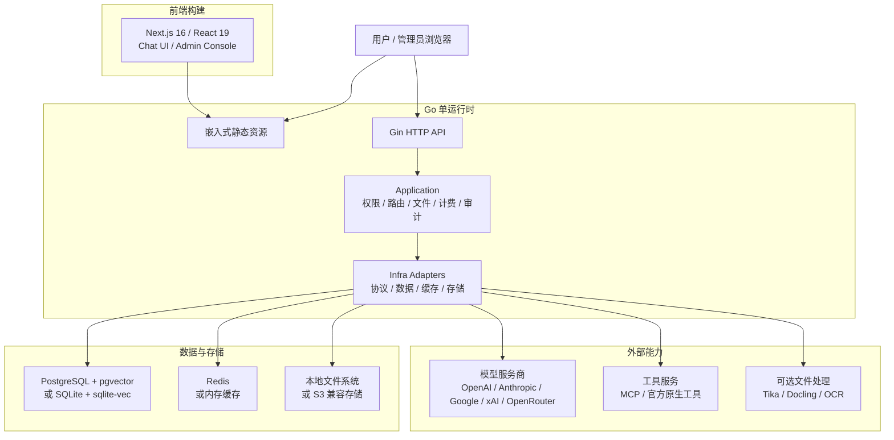

<p align="center">
  <picture>
    <source media="(prefers-color-scheme: dark)" srcset="../frontend/public/logo-white.svg" />
    
  </picture>
</p>

<p align="center">
  你的“外置大脑”：一个对话框，简单高效地解决一切。
</p>

<p align="center">
  <a href="../README.md">English</a> | 简体中文
</p>

<p align="center">
  <a href="https://github.com/lieyanc/FireCortex/releases"></a>
  <a href="https://www.apache.org/licenses/LICENSE-2.0"></a>
  
  
  
</p>

## 项目简介

FireCortex 是一个可自托管的 AI 工作台，核心理念只有一个：一个对话框就够了。你不需要手动挑选模型、开关工具或编排步骤，FireCortex 像“外置大脑”一样决定每个请求该如何处理：

- **智能模型路由**：按任务类型、所需能力、上下文长度、延迟与成本，为每个请求选择最合适的模型。
- **自适应工具注入**：只向当前请求暴露真正需要的工具、MCP 服务、文件与记忆，让提示词保持精简、工具选择更准确。
- **Agent Runtime**：规划、调用工具、观察结果并多步迭代直至任务完成，每一步都可追溯。

FireCortex 基于 [DEEIX Chat](https://github.com/DEEIX-AI/DEEIX-Chat) v0.4.3 二次开发，继承其生产级基础能力：多上游模型接入、文件与 RAG、MCP 工具、计费、身份、审计以及轻量的单运行时部署。 <!-- rebrand:keep -->

## 路线图

| 能力 | 状态 |
| --- | --- |
| 品牌重构为 FireCortex | 已完成 |
| 智能模型路由 | 规划中 |
| 自适应工具注入 | 规划中 |
| Agent Runtime | 规划中 |

## 核心能力

以下能力继承自上游，当前即可使用。

| 模块 | 能力 |
| --- | --- |
| 对话体验 | 面向日常高频使用的多模态对话界面，支持流式响应、多分支、重试、编辑、反馈、分享、富文本渲染和可追踪的模型执行信息。 |
| 模型与路由 | 以平台模型为统一入口管理上游渠道、真实模型、路由绑定、优先级、权重、熔断、厂商映射和能力配置，降低多供应商接入后的维护成本。 |
| 协议与适配 | 统一适配 OpenAI、Anthropic、Google/Gemini、xAI、OpenRouter 和 OpenAI 兼容协议，覆盖文本、图片、工具和不同厂商的原生能力差异。 |
| 文件与检索 | 提供文件上传、预览、提取、OCR、存储配额、全文注入、分片、向量嵌入和语义检索能力，让文件内容自然进入对话上下文。 |
| 工具生态 | 同时支持 MCP Server 和厂商官方原生工具，覆盖工具发现、启停、用户选择、执行限制、结果渲染和调用链路追踪。 |
| 上下文与记忆 | 支持消息窗口、Token 预算、压缩摘要、会话记忆、长期记忆和 RAG 证据记录，在可控成本下维持连续对话体验。 |
| 计费与支付 | 内置模型定价、工具按次定价、订阅、充值、余额、用量账本、计费快照、Stripe Checkout、易支付和 Webhook 校验。 |
| 身份与安全 | 覆盖本地账号、会话管理、HttpOnly Refresh Cookie、2FA/TOTP、可信设备、SSO/OIDC/OAuth、联系方式验证和敏感信息加密。 |
| 管理与审计 | 后台集中管理用户、角色、上游、模型、路由、价格、订阅、余额、调用日志、审计日志、认证事件和系统事件。 |
| 部署与运维 | 支持单个自包含二进制托管前端与 API、基于 GitHub Releases 的内置 OTA 更新、SQLite 或 PostgreSQL、内存缓存或 Redis、S3 兼容存储、Swagger、结构化日志、版本接口、GeoIP 和 OpenTelemetry。 |

## 系统架构与技术栈

FireCortex 采用前后端分离开发、单运行时部署的结构。前端构建为静态资源后嵌入 Go 二进制并由其统一托管，API、权限、模型路由、文件、计费和审计等后端能力由同一个运行时提供；文档提取、OCR 等重型能力以可选服务接入，避免基础部署过重。



| 层面 | 职责 | 主要技术 |
| --- | --- | --- |
| 前端 | 用户对话、后台管理、静态构建 | Next.js 16、React 19、TypeScript、Tailwind CSS、Shadcn/UI、Streamdown、KaTeX、Mermaid、Recharts、Motion |
| 后端运行时 | API、认证授权、业务编排、协议适配、静态资源托管 | Go 1.26、Gin、Gorm、Swagger、OpenTelemetry、Zap |
| 数据与缓存 | 领域数据、向量检索、会话状态、运行时缓存 | PostgreSQL、pgvector、SQLite、sqlite-vec、Redis、内存缓存 |
| 文件与存储 | 上传文件、生成文件、对象存储和本地持久化 | 本地文件系统、S3 兼容对象存储 |
| 文件处理 | 文本提取、OCR、文档解析和 LLM OCR 回退 | 内置提取、Apache Tika、Docling、RapidOCR、Tesseract OCR、Paddle OCR、云 OCR 适配、MinerU |
| 工具协议 | MCP 工具接入和厂商官方原生工具调用 | MCP Streamable HTTP JSON-RPC、Provider Native Tools |
| 部署运行 | 单节点轻量部署或多节点生产部署 | 内嵌界面的单二进制、systemd、OTA 自更新、SQLite/内存缓存、PostgreSQL/Redis |

后端内部保持清晰分层：`backend/cmd/server` 是可执行入口，`backend/internal/cli` 负责进程启动，`backend/internal/app` 负责应用装配和依赖注入，`backend/internal/transport/http` 负责 HTTP 边界。请求随后经过 `application` 用例层，依赖消费方定义的 `repository` 或 `ports` 接口，再由 `infra` 提供具体实现。数据层按领域前缀组织表结构，财务流水、审计日志、系统事件和高增长向量数据保持独立事实源。

## 仓库目录

```text
.
├── backend/                  # Go API 与单运行时服务
│   ├── cmd/server/            # 可执行入口
│   ├── internal/
│   │   ├── cli/               # 进程启动
│   │   ├── app/               # 依赖注入与生命周期
│   │   ├── application/       # 用例与业务编排
│   │   ├── domain/            # 业务概念与规则
│   │   ├── ports/              # 外部集成契约
│   │   ├── repository/         # 持久化契约
│   │   ├── infra/              # 持久化、缓存、存储和服务商适配
│   │   ├── transport/http/     # Handler、DTO、中间件和路由
│   │   ├── webui/              # 嵌入的 Web 界面（go:embed）
│   │   └── shared/             # 响应、安全等横切代码
│   └── docs/                  # 生成的 Swagger 文件
├── frontend/                 # Next.js App Router 与静态导出
│   ├── app/                   # 路由入口和布局
│   ├── features/              # 按业务域组织的 UI 与客户端流程
│   ├── entities/              # 可复用业务实体
│   ├── shared/                # API、认证、UI、hooks、模型和工具
│   ├── components/            # 基础 UI 与视觉组件
│   └── public/                # 静态资源
├── packages/api-contract/     # 生成的 TypeScript API 契约
├── docker/                    # 可选文档提取与 OCR 服务
├── deploy/                    # systemd 单元示例
├── docs/                      # 项目指南
├── scripts/                   # 二进制构建、品牌替换和上游同步脚本
└── config*.example.yaml       # 部署方案配置模板
```

`frontend/` 和 `backend/` 是由 pnpm 与 Turborepo 管理的独立工作区。`packages/api-contract/` 通过生成的 Swagger 类型连接两者；修改 HTTP 契约时先更新 Go 传输层，再重新生成共享包。

## 开发前置条件

- Node.js 20.9 或更高版本，用于开发（发布构建和 CI 使用 Node.js 24）。
- pnpm 10.17.0，通常通过 Corepack 启用。
- Go 1.26.8，用于后端开发。
- C 编译器和 SQLite 头文件（Debian/Ubuntu 上为 `libsqlite3-dev`），因为后端使用 CGO 构建。
- 带 pgvector 的 PostgreSQL 和 Redis，用于默认开发配置。

运行发布版二进制不需要以上任何依赖。SQLite 方案不要求单独管理数据库或缓存。默认开发配置使用 PostgreSQL 和 Redis。

## 快速开始

> 快速安装教程：[快速开始](https://github.com/lieyanc/FireCortex)。

### 本地开发

本地开发适合改动源码并分别启动前后端。默认配置连接本机 PostgreSQL 和 Redis；如果只是低依赖试用，建议直接使用发布版二进制配合下面的 SQLite 轻量方案。

1. 准备后端配置：

```bash
cp config.example.yaml config.yaml
```

根据本机环境调整 `config.yaml` 中的 `database.postgres.dsn`、`database.redis.*` 和公开访问地址。

2. 安装工作区依赖并准备前端环境：

```bash
pnpm install
cp frontend/.env.example frontend/.env.local
```

3. 同时启动前端和后端：

```bash
pnpm dev
```

只启动单个工作区时，使用 `pnpm dev:web` 或 `pnpm dev:api`。

前端请求后端使用 `NEXT_PUBLIC_API_BASE_URL`。本地开发时确认 `frontend/.env.local` 中包含：

```env
NEXT_PUBLIC_API_BASE_URL=http://127.0.0.1:8080
```

服务地址与探针：

| 服务 | 地址 |
| --- | --- |
| 前端 | `http://localhost:3000` |
| API | `http://localhost:8080` |
| 存活探针 | `http://localhost:8080/healthz` |
| 就绪探针 | `http://localhost:8080/readyz` |
| 版本接口 | `http://localhost:8080/api/v1/version` |
| Swagger（仅开发环境） | `http://localhost:8080/swagger/index.html` |

不配置 `NEXT_PUBLIC_API_BASE_URL` 时，本地默认指向 `localhost:8080`；同源部署默认请求当前 origin。

### 工作区命令

以下命令均从仓库根目录执行：

| 命令 | 用途 |
| --- | --- |
| `pnpm dev` | 以监听模式同时启动前端和后端。 |
| `pnpm dev:web` | 只启动 Next.js 前端。 |
| `pnpm dev:api` | 只启动 Go API。 |
| `pnpm check` | 执行工作区 lint、类型、后端版本和 API 契约检查。 |
| `pnpm test` | 执行工作区测试。 |
| `pnpm build` | 构建静态前端和后端二进制文件。 |
| `pnpm build:binary` | 构建内嵌界面的单个自包含二进制文件，输出到 `dist/firecortex`。 |
| `pnpm verify` | 一次执行检查、测试和构建。 |
| `pnpm api:generate` | 重新生成 Swagger 文件和 TypeScript API 类型。 |
| `pnpm api:check` | 检查生成的 API 文件是否与源码同步。 |

前端以静态资源形式导出，`pnpm build` 会把浏览器产物写入 `frontend/out`。`pnpm build:binary` 会把该产物嵌入 Go 二进制，详见[从源码构建](#从源码构建)。

### 二进制部署

FireCortex 以单个自包含二进制文件发布。Web 界面嵌入在可执行文件中，同一个进程在 `server.http_port`（默认 `8080`）上同时提供 API 和界面。每个 [GitHub Release](https://github.com/lieyanc/FireCortex/releases) 包含：

| 文件 | 平台 |
| --- | --- |
| `firecortex-linux-amd64` | Linux x86-64，需要 glibc 2.35 或更高版本（Debian 12+、Ubuntu 22.04+） |
| `firecortex-linux-arm64` | Linux ARM64，需要 glibc 2.35 或更高版本（Debian 12+、Ubuntu 22.04+） |
| `firecortex-darwin-arm64` | Apple 芯片 macOS |
| `SHA256SUMS` | 各二进制文件的 SHA-256 校验和 |
| `version.json` | 内置更新器使用的发布元数据 |

正式版由 `vX.Y.Z` 标签发布。每次推送到 `dev` 分支还会在 `dev-latest` 标签下滚动发布一个预发布版本。不提供 Windows 构建。

先选择配置方案：

| 方案 | 适合场景 | 配置文件 | 外部服务 |
| --- | --- | --- | --- |
| 轻量安装 | 本地试用、个人部署、小型单节点 | `config.sqlite.example.yaml` | 无，SQLite + sqlite-vec + 内存缓存 |
| PostgreSQL + Redis | 多节点或高并发生产部署 | `config.full.example.yaml` | 带 pgvector 的 PostgreSQL、Redis |
| 开发 | 配合 `pnpm dev` 进行源码开发 | `config.example.yaml` | 带 pgvector 的 PostgreSQL、Redis |

SQLite + memory cache 只适合单进程。多节点、高并发或更严格的生产部署建议使用 PostgreSQL + Redis。

#### 1. 安装二进制文件

以下命令把 Linux x86-64 的最新正式版安装到 `/opt/firecortex`。其他平台请替换文件名；如需跟随 `dev` 预发布版本，把 `latest/download` 替换为 `download/dev-latest`。

```bash
sudo install -d /opt/firecortex && cd /opt/firecortex
base=https://github.com/lieyanc/FireCortex/releases/latest/download
sudo curl -fLO "$base/firecortex-linux-amd64"
sudo curl -fLO "$base/SHA256SUMS"
sha256sum -c SHA256SUMS --ignore-missing
sudo mv firecortex-linux-amd64 firecortex
sudo chmod +x firecortex
```

macOS 上使用 `shasum -a 256 -c SHA256SUMS --ignore-missing` 校验。

#### 2. 准备 `config.yaml`

二进制文件会按运行目录读取 `./config.yaml` 或 `../config.yaml`，也可以通过 `CONFIG_FILE` 指定。配置文件中的相对路径（例如 `./data/firecortex.db` 和 `./storage`）以配置文件所在目录为基准解析。

```bash
ref=dev   # 或已安装版本的发布标签
sudo curl -fL -o config.yaml "https://raw.githubusercontent.com/lieyanc/FireCortex/$ref/config.sqlite.example.yaml"
```

PostgreSQL + Redis 方案改用 `config.full.example.yaml`。对外提供服务前，请设置 `app.env: prod`，把 `security.jwt_secret` 和 `security.data_encryption_key` 替换为高强度随机值，并把 `server.public_api_base_url`、`server.public_web_base_url` 和 `server.cors_allow_origin` 设置为公开的 HTTPS 地址。

PostgreSQL + Redis 方案要求宿主机能访问这两个服务。Embedding、RAG 和语义上下文需要 PostgreSQL 的 pgvector 扩展；FireCortex 启动时会执行 `CREATE EXTENSION IF NOT EXISTS vector`，如果应用账号无权创建扩展，请先用超级用户执行一次。如果希望用容器运行这些依赖，以下命令与 `config.full.example.yaml` 中的凭据一致（正式部署请修改密码）：

```bash
docker run -d --name firecortex-postgres --restart unless-stopped \
  -e POSTGRES_USER=firecortex -e POSTGRES_PASSWORD=firecortex_2026 -e POSTGRES_DB=firecortex \
  -p 127.0.0.1:5432:5432 -v firecortex-postgres-data:/var/lib/postgresql/data \
  pgvector/pgvector:pg16
docker run -d --name firecortex-redis --restart unless-stopped \
  -p 127.0.0.1:6379:6379 -v firecortex-redis-data:/data \
  redis:7 redis-server --requirepass firecortex_2026
```

#### 3. 运行

快速试用时，在 `config.yaml` 所在目录直接运行二进制文件：

```bash
./firecortex
```

长期运行建议使用 [`deploy/firecortex.service`](../deploy/firecortex.service) 中的 systemd 单元。它以专用 `firecortex` 用户从 `/opt/firecortex` 运行 FireCortex，启用 `Restart=always`，并在文件系统加固的同时保留 `/opt/firecortex` 的写权限以支持自更新：

```bash
sudo useradd --system --home-dir /opt/firecortex --shell /usr/sbin/nologin firecortex
sudo chown -R firecortex:firecortex /opt/firecortex
sudo chmod 600 /opt/firecortex/config.yaml
sudo curl -fL -o /etc/systemd/system/firecortex.service \
  "https://raw.githubusercontent.com/lieyanc/FireCortex/$ref/deploy/firecortex.service"
sudo systemctl daemon-reload
sudo systemctl enable --now firecortex
```

服务在所有网卡上监听 `server.http_port`。公网访问时请用防火墙限制该端口，并在前面放置负责 TLS 的反向代理。

#### 配置与持久化

配置优先级是：`环境变量 > config.yaml > 代码内置默认值`。`config.yaml` 负责品牌和静态基础设施、安全配置，例如品牌资源、服务地址、数据库、缓存、存储、GeoIP、Trace、更新、JWT 和加密密钥。运行时业务配置存储在数据库中，并通过后台管理修改。

使用示例配置时，持久化数据位于 `config.yaml` 旁边：

| 数据 | 默认路径 |
| --- | --- |
| SQLite 数据库 | `./data/firecortex.db`，仅轻量安装 |
| 上传文件和生成文件 | `./storage` |
| GeoIP MMDB 缓存 | `./data/geoip/` |
| 下载的更新 | `./data/updates` |

请备份 `config.yaml`、`data/` 和 `storage/`（或 PostgreSQL 数据库与 S3 存储桶）。`data_encryption_key` 在重启和升级之间必须保持不变，否则数据库中加密保存的密钥将无法读取。

`APP_ENV` 支持 `dev`/`development` 和 `prod`/`production`，内部会规范化为 `dev` 或 `prod`；未配置时默认 `prod`。`dev` 只用于本地开发；公网生产部署应保持 `APP_ENV=prod` 或 `APP_ENV=production` 并使用生产密钥。

#### 可选安装服务

这些文档提取和 OCR 服务是可选的独立旁路服务，FireCortex 通过 URL 调用，只需启动后台中启用的服务。`docker/` 下的 compose 文件会接入外部 Docker 网络 `firecortex-network`，启动前先创建一次：

```bash
docker network create firecortex-network
docker compose -f docker/tika/docker-compose.yml up -d
docker compose -f docker/tesseract/docker-compose.yml up -d --build
docker compose -f docker/docling/docker-compose.yml up -d --build
```

默认本地地址：

| 服务 | 地址 | 用途 |
| --- | --- | --- |
| Tika | `http://127.0.0.1:9998` | 文档文本提取 |
| Tesseract OCR | `http://127.0.0.1:8004/ocr` | OCR 服务 |
| Docling | `http://127.0.0.1:8005/ocr` | 文档/OCR 提取 |
| RapidOCR | `http://127.0.0.1:8002/ocr` | OCR 服务 |

`docker/rapidocr` 提供 Dockerfile 和服务入口，但没有 compose 文件。请在仓库根目录构建并运行：

```bash
docker build -t firecortex-rapidocr:latest -f docker/rapidocr/Dockerfile .
docker run -d --name firecortex-rapidocr --network firecortex-network \
  -p 127.0.0.1:8002:8002 --restart unless-stopped firecortex-rapidocr:latest
```

### 更新

FireCortex 会从 GitHub Releases 自我更新。管理员可以在 **后台管理 → 关于** 中查看当前版本和更新状态，点击 **检查更新** 会查询所配置的通道，并提供下载和应用新版本的操作。无论是否开启自动检查，手动检查都可用。

| 通道 | 跟随版本 | 自动行为 |
| --- | --- | --- |
| `stable` | `vX.Y.Z` 正式版 | 下载新版本并在校验通过后自动重启。 |
| `dev` | 滚动预发布版本 `dev-latest` | 下载新构建，然后等待管理员确认后重启。 |

设置 `update.enabled: true` 后，服务会每隔 `update.check_interval_seconds`（最小 `60`）在后台检查一次。

应用更新的过程：

1. 把当前平台的二进制文件下载到 `update.download_dir`，并用该版本的 `SHA256SUMS` 校验。校验是强制的：缺少 `SHA256SUMS`、没有当前平台条目或哈希不一致的版本都会被拒绝。
2. 服务最多等待 10 分钟让进行中的对话生成完成，然后像收到 `SIGTERM` 一样排空 HTTP 连接。
3. 原地替换自身可执行文件并以相同 PID 重新执行，systemd 不会感知到重启。

要求与注意事项：

- 进程需要对可执行文件所在目录和 `update.download_dir` 拥有写权限。仓库提供的 systemd 单元已为 `/opt/firecortex` 满足这一点。
- 完整性只依赖 SHA-256 校验和，发布文件没有签名，信任基础是 HTTPS 和 GitHub。使用 `update.source: proxy` 时下载经过 `update.proxy_base_url`，请只使用你自己控制的镜像主机。
- 新版本启动失败时没有自动回滚。请在 systemd 中保留 `Restart=always`，至少保证崩溃后会重启。需要回滚或手动更新时，按安装步骤下载目标版本，再执行 `sudo systemctl restart firecortex`。

```yaml
update:
  enabled: false
  channel: stable                 # stable 或 dev
  check_interval_seconds: 3600
  source: github                  # github 或 proxy
  proxy_base_url: "https://dl.repo.chycloud.top"
  repo: lieyanc/FireCortex
  download_dir: ./data/updates
```

### 从源码构建

后端通过 CGO 使用 go-sqlite3 和 sqlite-vec，因此构建二进制需要 Go（版本见 `backend/go.mod`）、Node.js 24 与 pnpm、C 编译器，以及 SQLite 头文件（Debian/Ubuntu 上为 `libsqlite3-dev`）。

```bash
pnpm install
pnpm build:binary
```

脚本会构建 Next.js 静态导出，将其放入 `backend/internal/webui/dist`，再启用 CGO 执行 `go build`。产物为 `dist/firecortex`，用法与发布版二进制完全相同。由于依赖 CGO，请在目标操作系统和架构上构建。

嵌入的界面会以同源方式请求 API。构建用于部署的二进制时，请不要设置 `NEXT_PUBLIC_API_BASE_URL`（包括 `frontend/.env.local` 中的设置）。

`server.frontend_dist_dir`（`FRONTEND_DIST_DIR`）默认为空，表示使用嵌入的界面。设置为目录（例如 `./frontend/out`）时会改为从磁盘提供界面，仅用于开发或调试。

### 分离部署

当前端和后端分别暴露在不同公网地址时使用分离部署，例如 `https://chat.example.com` 和 `https://api.example.com`。

1. 配置公开地址。

   - 前端构建变量：`NEXT_PUBLIC_API_BASE_URL=https://api.example.com`
   - 后端配置：`server.public_api_base_url=https://api.example.com`
   - 后端配置：`server.public_web_base_url=https://chat.example.com`
   - 后端配置：`server.cors_allow_origin=https://chat.example.com`

2. 构建并发布前端。

   ```bash
   pnpm install
   NEXT_PUBLIC_API_BASE_URL=https://api.example.com pnpm --filter @firecortex/web build
   ```

   静态产物在 `frontend/out`，可由 Nginx、CDN、对象存储或任意静态服务托管。后端二进制仍会在 API 地址上提供自身嵌入的界面，不影响单独托管的这份前端。

3. 配置 CDN 规则。

   | 路径 | 规则 |
   | --- | --- |
   | `/_next/static/*` | 缓存 1 年，并启用 immutable 静态资源缓存。 |
   | `/logo*.svg`、`/*.ico`、`/*.png`、`/*.jpg`、`/*.webp`、`/*.woff2` | 缓存 1 天到 30 天。 |
   | `/`、`/*.html`、`/login*`、`/auth*`、`/chat*`、`/recent*`、`/files*`、`/knowledges*`、`/skills-prompt*`、`/setting*`、`/admin*`、`/share*`、`/preview*` | 不做长期缓存，建议使用 `no-cache` 或较短 TTL。 |
   | `/api/*`、`/healthz`、`/readyz`、`/swagger/*` | 绕过 CDN 缓存，并完整转发请求头、方法、查询参数和请求体。 |

   如果 CDN 从对象存储托管 `frontend/out`，需要开启路由回退，让无扩展名地址能命中导出的 `index.html`，例如 `/chat` -> `/chat/index.html`。

### 启动后检查与首次登录

应用启动后，先确认存活、就绪、版本和启动日志。systemd 部署可用：

```bash
curl http://localhost:8080/healthz
curl http://localhost:8080/readyz
curl http://localhost:8080/api/v1/version
systemctl status firecortex
journalctl -u firecortex -e
```

只有 `APP_ENV=dev` 或 `APP_ENV=development` 时才会注册 Swagger；生产部署不会暴露 Swagger UI 路由。

如果数据库中还不存在超级管理员，后端会在首次启动时自动创建初始管理员，并且只在创建当次输出一次初始密码。

| 项目 | 说明 |
| --- | --- |
| 初始用户名 | `admin` |
| 初始密码 | 查看后端启动日志，搜索 `bootstrap superadmin created`，读取其中的 `password` 字段。 |
| 首次登录 | 系统会要求修改用户名和密码。 |
| 后续变更 | 通过账户流程或后台管理完成；不会通过 `config.yaml` 修改。 |

如果数据库中已经存在超级管理员，服务不会重新生成或再次输出初始密码。

## 配置说明

> 完整配置说明：[配置说明](https://github.com/lieyanc/FireCortex)。

后端配置分为静态运行配置和运行时业务配置。静态运行配置用于描述品牌以及服务启动所需的基础设施、安全和存储参数，由 `config.yaml` 与环境变量提供；运行时业务配置用于认证、会话、模型、文件、计费等产品能力，写入 `system_settings` 并通过后台管理维护。环境变量会覆盖配置文件中的同名项，适合 systemd `Environment=` 覆盖、分离部署和密钥注入场景。

后端启动时会按运行目录解析默认配置文件：从仓库根目录启动读取 `config.yaml`，从 `backend/` 目录启动读取 `../config.yaml`。配置文件中的相对路径以配置文件所在目录为基准解析；如果配置文件放在其他位置，请使用 `CONFIG_FILE` 指向运行进程可访问的路径。最终生效优先级是 `环境变量 > config.yaml > 代码内置默认值`。

前端品牌同样属于运行时配置。在 `config.yaml` 中设置 `branding` 后重启应用即可生效，无需重新构建前端或二进制文件。详见[自定义品牌资源](./BRANDING.md)。

静态配置环境变量：

| 所属域 | 环境变量 | 说明 |
| --- | --- | --- |
| 前端构建 | `NEXT_PUBLIC_API_BASE_URL` | 浏览器请求后端 API 的地址；本地写入 `frontend/.env.local`，分离部署在构建时传入。 |
| 配置文件 | `CONFIG_FILE` | 可选配置文件路径。 |
| 应用 | `APP_NAME` | 应用名称。 |
| 应用 | `APP_ENV` | 运行环境，支持 `dev`/`development` 和 `prod`/`production`；未配置时默认 `prod`。 |
| HTTP 服务 | `HTTP_PORT` | API/运行时端口。 |
| HTTP 服务 | `CORS_ALLOW_ORIGIN` | 允许跨域访问的来源，多个来源用逗号分隔。 |
| HTTP 服务 | `TRUSTED_PROXIES` | 可信代理 CIDR 列表。 |
| HTTP 服务 | `PUBLIC_API_BASE_URL` | 对外 API 地址，用于链接、回调和公开地址生成。 |
| HTTP 服务 | `PUBLIC_WEB_BASE_URL` | 对外 Web 地址，用于链接、回调和公开地址生成。 |
| HTTP 服务 | `FRONTEND_DIST_DIR` | 可选目录，用于覆盖嵌入的 Web 界面；为空时使用嵌入界面。仅用于开发或调试。 |
| HTTP 服务 | `HTTP_READ_HEADER_TIMEOUT_SECONDS` | HTTP 读取请求头超时。 |
| HTTP 服务 | `HTTP_READ_TIMEOUT_SECONDS` | HTTP 请求读取超时。 |
| HTTP 服务 | `HTTP_IDLE_TIMEOUT_SECONDS` | HTTP keep-alive 空闲超时。 |
| HTTP 服务 | `HTTP_MAX_HEADER_BYTES` | HTTP 请求头最大字节数。 |
| 安全 | `JWT_SECRET` | JWT 签名密钥。 |
| 安全 | `DATA_ENCRYPTION_KEY` | 上游 API Key、SSO Secret、MCP Token、敏感设置和 TOTP Secret 的加密密钥材料。 |
| 安全 | `SSRF_PROTECTION_ENABLED` | 是否启用出站 SSRF 防护。 |
| 安全 | `SSRF_ALLOWED_HOSTS` | 部署级集成或可信私网重定向目标的主机名，逗号分隔。 |
| 安全 | `SSRF_ALLOWED_CIDRS` | 部署级集成或可信私网重定向目标的 CIDR 网段，逗号分隔。 |
| 安全 | `TURNSTILE_SITEVERIFY_URL` | Cloudflare Turnstile siteverify 端点。 |
| 数据库 | `DATABASE_DRIVER` | `postgres` 或 `sqlite`。 |
| PostgreSQL | `POSTGRES_DSN` | PostgreSQL DSN。 |
| PostgreSQL | `POSTGRES_MAX_OPEN_CONNS` | 最大打开连接数。 |
| PostgreSQL | `POSTGRES_MAX_IDLE_CONNS` | 最大空闲连接数。 |
| PostgreSQL | `POSTGRES_CONN_MAX_LIFETIME_MINUTES` | 连接最长生命周期。 |
| PostgreSQL | `POSTGRES_CONN_MAX_IDLE_TIME_MINUTES` | 连接最长空闲时间。 |
| SQLite | `SQLITE_PATH` | 数据库文件路径。 |
| SQLite | `SQLITE_DSN` | 完整 DSN；设置后优先于路径拼装。 |
| SQLite | `SQLITE_MAX_OPEN_CONNS` | 最大打开连接数，默认 `1`。 |
| SQLite | `SQLITE_BUSY_TIMEOUT_MS` | busy timeout。 |
| SQLite | `SQLITE_CACHE_SIZE_KB` | page cache 大小。 |
| SQLite | `SQLITE_MMAP_SIZE_BYTES` | mmap 大小。 |
| SQLite | `SQLITE_SYNCHRONOUS` | 同步模式：`OFF`、`NORMAL`、`FULL`、`EXTRA`。 |
| SQLite | `SQLITE_TEMP_STORE` | 临时存储：`DEFAULT`、`FILE`、`MEMORY`。 |
| 缓存 | `CACHE_DRIVER` | `redis` 或 `memory`；`memory` 仅适用于单进程。 |
| Redis | `REDIS_ADDR` | Redis 地址。 |
| Redis | `REDIS_USERNAME` | Redis ACL 用户名；使用仅密码或默认用户 Redis 时留空。 |
| Redis | `REDIS_PASSWORD` | Redis 密码。 |
| Redis | `REDIS_DB` | Redis DB 编号。 |
| Redis | `REDIS_TLS_ENABLED` | 启用 Redis TLS 连接，例如 Upstash Redis。 |
| Redis | `REDIS_TLS_INSECURE_SKIP_VERIFY` | 跳过 Redis TLS 证书校验；除非非标准端点确实要求，否则保持 `false`。 |
| 存储 | `STORAGE_BACKEND` | `local` 或 `s3`。 |
| 本地存储 | `STORAGE_ROOT_DIR` | 本地文件存储目录。 |
| S3 存储 | `STORAGE_S3_ENDPOINT` | S3 兼容服务 endpoint。 |
| S3 存储 | `STORAGE_S3_REGION` | S3 region；使用 S3 时必填。 |
| S3 存储 | `STORAGE_S3_BUCKET` | S3 bucket；使用 S3 时必填。 |
| S3 存储 | `STORAGE_S3_PREFIX` | S3 对象前缀。 |
| S3 存储 | `STORAGE_S3_ACCESS_KEY_ID` | S3 Access Key ID。 |
| S3 存储 | `STORAGE_S3_SECRET_ACCESS_KEY` | S3 Secret Access Key。 |
| S3 存储 | `STORAGE_S3_FORCE_PATH_STYLE` | 是否使用 path-style 访问。 |
| GeoIP | `GEOIP_PROVIDER` | `none`、`ipwhois`、`ipinfo` 或 `mmdb`。 |
| GeoIP | `GEOIP_BASE_URL` | GeoIP HTTP 服务地址，默认 `https://ipwho.is`。 |
| GeoIP | `GEOIP_TOKEN` | GeoIP 服务 Token。 |
| GeoIP | `GEOIP_TIMEOUT_MS` | GeoIP 请求超时。 |
| GeoIP | `GEOIP_DATABASE_URL` | MMDB 下载地址。 |
| GeoIP | `GEOIP_DATABASE_PATH` | MMDB 本地路径。 |
| GeoIP | `GEOIP_DATABASE_MAX_BYTES` | MMDB 最大下载字节数。 |
| GeoIP | `GEOIP_REFRESH_INTERVAL_HOURS` | MMDB 刷新间隔。 |
| OpenTelemetry | `OTEL_ENABLED` | 是否启用 Trace；未显式设置时，配置 endpoint 会自动启用。 |
| OpenTelemetry | `OTEL_EXPORTER_OTLP_ENDPOINT` | OTLP Collector 地址。 |
| OpenTelemetry | `OTEL_EXPORTER_OTLP_HEADERS` | OTLP 请求头，格式为 `key=value,key2=value2`。 |
| OpenTelemetry | `OTEL_EXPORTER_OTLP_INSECURE` | 是否使用明文传输。 |
| OpenTelemetry | `OTEL_EXPORTER_OTLP_PROTOCOL` | OTLP exporter 协议：`grpc`、`http` 或 `http/protobuf`；默认 `grpc`。 |
| OpenTelemetry | `OTEL_TRACES_SAMPLER_ARG` / `OTEL_SAMPLING_RATE` | Trace 采样率，范围 `0~1`；`OTEL_TRACES_SAMPLER_ARG` 优先。 |
| 更新 | `UPDATE_ENABLED` | 是否启用后台自动检查更新；后台管理中的手动检查始终可用。 |
| 更新 | `UPDATE_CHANNEL` | `stable` 跟随 `vX.Y.Z` 正式版，`dev` 跟随滚动预发布版本 `dev-latest`。 |
| 更新 | `UPDATE_CHECK_INTERVAL_SECONDS` | 自动检查间隔（秒），最小 `60`。 |
| 更新 | `UPDATE_SOURCE` | `github` 直接从 GitHub 下载，`proxy` 使用 `UPDATE_PROXY_BASE_URL`。 |
| 更新 | `UPDATE_PROXY_BASE_URL` | `UPDATE_SOURCE=proxy` 时使用的下载镜像。 |
| 更新 | `UPDATE_REPO` | 发布版本的 GitHub 仓库，默认 `lieyanc/FireCortex`。 |
| 更新 | `UPDATE_DOWNLOAD_DIR` | 更新二进制的下载目录，默认 `./data/updates`。 |

认证、注册、会话配置、模型参数策略、文件处理、RAG、Embedding、MCP、计费、支付和公告等运行时业务配置不属于静态 YAML 配置，默认值由后端种子初始化，并在后台管理中维护。

生产环境启用 SSRF 防护后，管理员保存的模型、MCP、Embedding、OIDC/OAuth2 和自定义 Turnstile endpoint 均按精确 origin（协议、主机和端口）获得局部授权，不需要加入全局白名单。模型、MCP 与 Embedding 保留标准重定向兼容性：跨 origin 的公网目标可以继续访问，跨 origin 的私网目标必须命中 `SSRF_ALLOWED_HOSTS` 或 `SSRF_ALLOWED_CIDRS`；OIDC/OAuth2 与 Turnstile 继续维持更严格的身份边界。模型生成的图片或视频由后端下载、校验并转存：私网制品 URL 只有与本次选中的模型 endpoint 同 origin 时才继承该局部信任；跨 origin 的公网制品仍按严格公网策略下载，跨 origin 的私网制品会被拦截。全局白名单也继续用于无法绑定管理员保存 endpoint 的部署级集成，例如部分 GeoIP 或提取服务部署。链路本地、组播、未指定地址和已知云元数据目标始终禁止。白名单配置不合法会阻止后端启动；全局白名单修改后需重启生效。

### Web、App 与桌面端 OAuth 回调（多端暂未发布）

启用第三方授权桥前，请先把 `PUBLIC_API_BASE_URL` 配置为外部可访问的 API 地址。每个 OIDC/OAuth2 身份源都应登记后台身份源弹窗展示的服务器回调：

```text
<PUBLIC_API_BASE_URL>/api/v1/auth/providers/<provider-slug>/callback
```

Web、App 与桌面端会自动复用当前实例的这个回调。外部身份源的授权码和 Client Secret 始终留在用户自己的服务器；公共客户端只会收到一个短时、单次使用并绑定 PKCE verifier 的 FireCortex 授权码。如果仍需使用账号身份绑定或兼容旧版 Web 客户端，请同时保留后台展示的旧版 Web 回调地址。

## 功能指南

FireCortex 暂未提供独立的使用指南。继承自上游的功能可参考上游文档，阅读时将 DEEIX Chat 替换为 FireCortex，`DEEIX_*` 模板变量替换为 `FIRECORTEX_*`。 <!-- rebrand:keep -->

- [用户指南](https://deeix.com/zh/docs/deeix-chat/new-chat) <!-- rebrand:keep -->
- [管理指南](https://deeix.com/zh/docs/deeix-chat/admin-accounts) <!-- rebrand:keep -->
- [进阶指南](https://deeix.com/zh/docs/deeix-chat/advanced-capabilities-passthrough-tools) <!-- rebrand:keep -->

## 安全说明

- 用户密码使用 bcrypt 哈希存储。
- 生产模式会拒绝不安全的默认密钥、过短的加密密钥、通配 CORS 和非 HTTPS 公开地址。
- Refresh Token 和恢复类凭证只存储哈希。
- 上游 API Key、SSO Client Secret、MCP 鉴权 Token、敏感系统设置和 TOTP Secret 使用 `DATA_ENCRYPTION_KEY` 通过 AES-GCM 加密。
- Access Token 为短期令牌并保存在前端内存中；Refresh Token 由后端写入 HttpOnly Cookie。
- 用户输入的模型参数会在请求上游前经过白名单/黑名单过滤。模型名、消息、工具、系统提示词、请求头和 previous response 标识等系统链路字段不允许被用户 options 覆盖。

## 文档入口

- 上游同步流程：[docs/UPSTREAM.md](./UPSTREAM.md)
- 自定义品牌：[docs/BRANDING.md](./BRANDING.md)
- 后端说明：[backend/README.md](../backend/README.md)
- 后端规范：[backend/docs/README.md](../backend/docs/README.md)
- 前端说明：[frontend/README.md](../frontend/README.md)
- API 契约包：[packages/api-contract/README.md](../packages/api-contract/README.md)
- 贡献指南：[CONTRIBUTING.md](../.github/CONTRIBUTING.md)
- 安全策略：[SECURITY.md](../.github/SECURITY.md)
- Swagger UI（仅开发环境）：`http://localhost:8080/swagger/index.html`

## 鸣谢

FireCortex 基于开源生态构建，感谢所有 AI 工具生态中的维护者和社区。

- [DEEIX Chat](https://github.com/DEEIX-AI/DEEIX-Chat)：FireCortex 的上游项目 <!-- rebrand:keep -->
- [Next.js](https://nextjs.org)
- [Go](https://go.dev)
- [LINUX DO](https://linux.do)

## 联系&交流

- 问题反馈与功能建议：[GitHub Issues](https://github.com/lieyanc/FireCortex/issues)
- 安全漏洞报告：[GitHub Security Advisories](https://github.com/lieyanc/FireCortex/security/advisories/new)

## 开源协议

FireCortex 使用 [Apache License 2.0](../LICENSE) 授权，上游署名见 [NOTICE](../NOTICE)。
